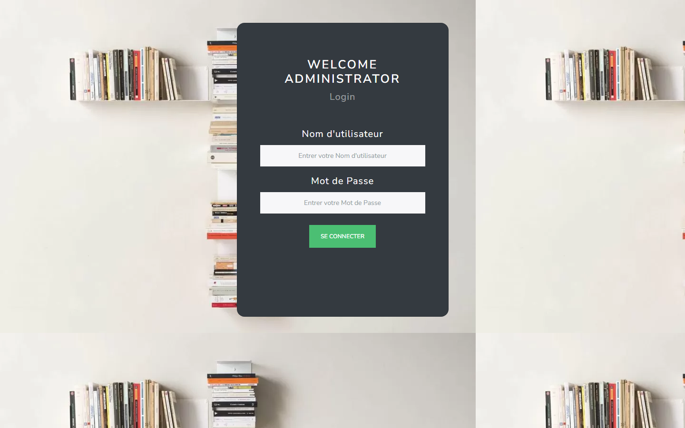
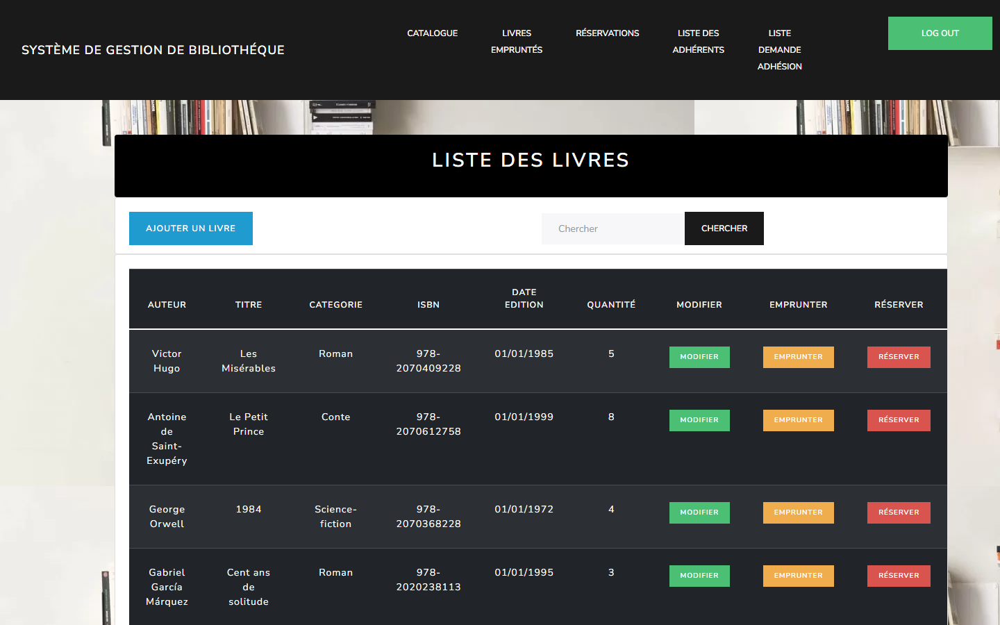
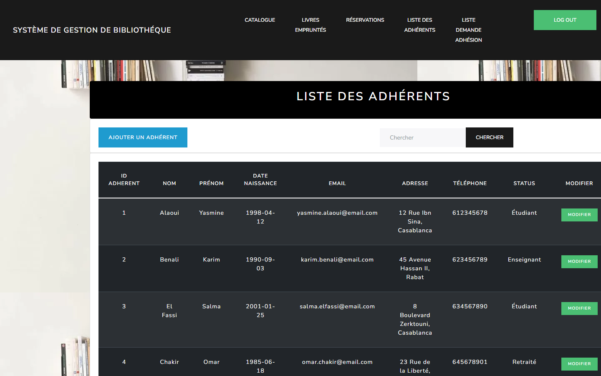
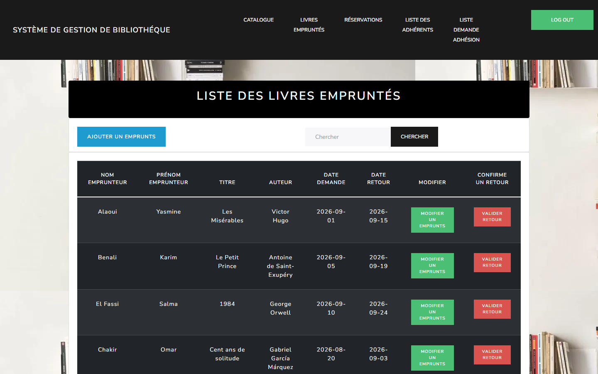
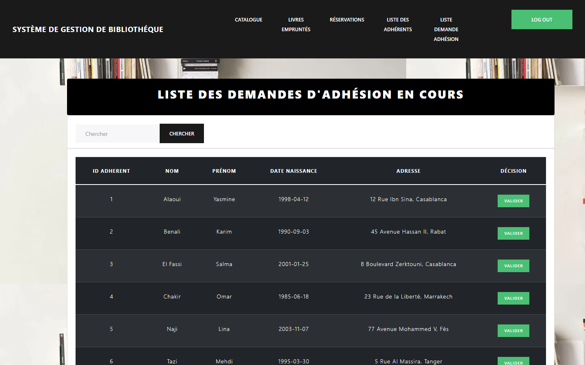
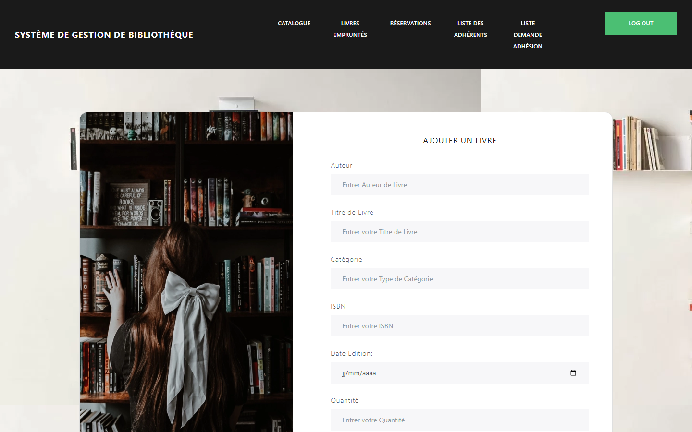

# Rapport final — Système de Gestion de Bibliothèque

## 1. Résumé exécutif

Ce projet consiste à concevoir et réaliser une application web de gestion de bibliothèque. Il couvre l'ensemble de la démarche : analyse du besoin, conception du modèle de données, implémentation d'une application **Spring Boot** en couches, mise en place de la sécurité, puis tests et démonstration à travers une interface web **Thymeleaf**.

L'application permet de gérer un catalogue d'ouvrages, les adhérents et la validation de leurs demandes d'adhésion, les emprunts et la confirmation des retours, ainsi qu'un espace de réservation. Le modèle métier s'articule autour de cinq entités persistées avec JPA/Hibernate : `Ouvrage`, `Adherent`, `Emprunt`, `Reservation` et `Administrateur`.

L'application compile et démarre correctement (BUILD SUCCESS, Java 21 / Spring Boot 3.2.5). Un profil de démonstration utilisant une base H2 en mémoire a été ajouté afin de rendre le projet exécutable et vérifiable sans dépendre d'un serveur MySQL. Les parcours principaux — catalogue, emprunts, adhérents, formulaires — ont été validés et illustrés par des captures d'écran.

## 2. Contexte, objectif et problématique

### 2.1 Contexte

La gestion d'une bibliothèque implique un suivi continu des ouvrages disponibles, des usagers inscrits, des livres empruntés et de leurs dates de retour. Réalisée manuellement, cette gestion engendre des pertes d'information, des doublons et des retards non détectés. L'informatisation du processus apporte une centralisation, une traçabilité et un contrôle d'accès.

### 2.2 Problématique

> Comment structurer et informatiser la gestion d'une bibliothèque afin de centraliser le catalogue, maîtriser le cycle des emprunts et des retours, et contrôler les adhésions des usagers, à travers une application web fiable et sécurisée ?

### 2.3 Objectif

Développer une application web qui :

1. centralise le catalogue des ouvrages ;
2. gère les adhérents et la validation des demandes d'adhésion ;
3. suit les emprunts, les dates de retour et confirme les retours ;
4. propose une fonctionnalité de réservation ;
5. protège l'accès par authentification et rôles (administrateur / utilisateur).

## 3. Analyse et conception

### 3.1 Acteurs

| Acteur | Rôle |
|---|---|
| Administrateur | Gère le catalogue, valide les adhésions, supervise les emprunts et les retours |
| Adhérent | Consulte le catalogue, emprunte et réserve des ouvrages |

### 3.2 Besoins fonctionnels

- Gestion du catalogue : ajouter, modifier, supprimer et rechercher un ouvrage.
- Gestion des adhérents : créer, modifier, supprimer un adhérent.
- Gestion des adhésions : afficher les demandes en attente et les valider.
- Gestion des emprunts : enregistrer un emprunt, modifier un emprunt, confirmer un retour.
- Réservation : réserver un ouvrage.
- Authentification : se connecter pour accéder aux fonctions d'administration.

### 3.3 Modèle de données

Cinq entités JPA constituent le cœur du domaine :

| Entité | Attributs principaux | Relations |
|---|---|---|
| `Ouvrage` | id, date_edition, titre, isbn, auteur, categorie, quantité | 1—N `Emprunt`, 1—N `Reservation` |
| `Adherent` | id, nom, prenom, date_naissance, email, adresse, telephone, type_adherent, valide | 1—N `Emprunt`, 1—N `Reservation` |
| `Emprunt` | id, nomEmprunteur, prenomEmprunteur, dateDemande, dateRetour, valide | N—1 `Ouvrage`, N—1 `Adherent`, N—1 `Reservation` |
| `Reservation` | id | N—1 `Ouvrage`, N—1 `Adherent`, N—1 `Emprunt` |
| `Administrateur` | id, username, password | — |

La cible de suivi métier est le cycle emprunt/retour, matérialisé par l'entité `Emprunt` et son attribut `valide` (retour confirmé ou non).

### 3.4 Architecture logicielle

Le projet suit une architecture en couches, classique des applications Spring Boot :

```text
Navigateur  →  Controller (MVC)  →  Service  →  Repository (JPA)  →  Base de données
                     │
                     └────→  Vue Thymeleaf (templates/)
```

- **Controller** : expose les routes web (`/ouvrages`, `/listeadherents`, `/ouvrages/emprunts`, etc.) et prépare les données pour les vues.
- **Service** : contient la logique métier (création, suppression, validation d'un retour ou d'une adhésion).
- **Repository** : interfaces `JpaRepository` assurant l'accès aux données.
- **Entity** : classes persistées annotées JPA.
- **Security** : `WebSecurity` configure l'authentification par formulaire et les rôles.

## 4. Implémentation

### 4.1 Stack technique

| Technologie | Rôle |
|---|---|
| Java 21 | Langage de programmation |
| Spring Boot 3.2.5 | Socle applicatif et auto-configuration |
| Spring Web MVC | Contrôleurs et routage |
| Spring Data JPA / Hibernate | Persistance objet-relationnel |
| Spring Security | Authentification et autorisation par rôles |
| Thymeleaf | Rendu des vues côté serveur |
| Bootstrap / Bootswatch / Font Awesome | Interface utilisateur |
| Maven (wrapper) | Build et gestion des dépendances |
| H2 | Base en mémoire (démonstration) |
| MySQL | Base relationnelle (configuration d'origine) |

### 4.2 Sécurité

La classe `WebSecurity` met en place :

- une page de connexion personnalisée (`/login`) ;
- une redirection par défaut vers `/ouvrages` après connexion ;
- une protection des routes : `/ouvrages` est réservée au rôle `ADMIN`, les autres requêtes nécessitent d'être authentifié ;
- deux comptes en mémoire pour la démonstration (`user` et `admin`).

Pour la démonstration, une configuration `SecurityDemoConfig` (profil `demo`) assouplit volontairement l'accès afin de permettre la visualisation sans écran de connexion.

### 4.3 Fonctionnalités par module

- **OuvrageController** : affichage du catalogue (`/ouvrages`), ajout (`/ajouterlivre`, `/enregistrer`), modification (`/modifier/{id}`), recherche par titre (`/ouvrages/recherche`), emprunt (`/ouvrages/emprunter/{id}`), liste des emprunts (`/ouvrages/emprunts`), confirmation d'un retour (`/retour/{empruntId}/valider`).
- **AdherentController** : liste des adhérents, création, modification, suppression, et validation d'une demande d'adhésion (`/adherents/valider/{id}`).
- **ReservationController** : accès à la page de réservation et endpoints de consultation.
- **Services** : `OuvrageService`, `AdherentService`, `EmpruntService`, `ReservationService` portent la logique métier et délèguent la persistance aux repositories.

### 4.4 Vues (Thymeleaf)

Douze templates composent l'interface : `login`, `ouvrages`, `ajouterLivre`, `modifierOuvrage`, `emprunt-form`, `emprunts`, `modifierEmprunts`, `listeadherents`, `listedemandeadherent`, `createAdherent`, `modifierAdherent`, `reservation`. Elles partagent une barre de navigation commune (Catalogue, Livres Empruntés, Réservations, Liste des adhérents, Liste Demande Adhésion, Log out).

### 4.5 Ajout du profil de démonstration

Afin de rendre le projet exécutable et vérifiable indépendamment d'un serveur MySQL, trois éléments ont été ajoutés (sans modifier le comportement en production) :

- `application-h2.properties` : configuration d'une base H2 en mémoire ;
- `application-demo.properties` : profil `demo` combinant H2 et sécurité assouplie ;
- `DataSeeder` : composant activé sous le profil `demo` qui peuple la base au démarrage (6 ouvrages, 6 adhérents dont 2 demandes en attente, 4 emprunts, 2 réservations) via la couche JPA.

## 5. Tests et vérification

Le projet a été compilé et exécuté pour valider son fonctionnement.

```powershell
$env:JAVA_HOME = "C:\Program Files\Java\jdk-21"
.\mvnw.cmd -q -DskipTests clean compile   # → BUILD SUCCESS (19 fichiers sources)
.\mvnw.cmd spring-boot:run -Dspring-boot.run.profiles=demo
```

Résultats observés :

| Vérification | Résultat |
|---|---|
| Compilation Maven | BUILD SUCCESS |
| Démarrage de l'application | Tomcat démarré sur le port 8989 |
| `GET /ouvrages` (catalogue) | HTTP 200, données du seeder affichées |
| `GET /ouvrages/emprunts` | HTTP 200, emprunts listés |
| `GET /listeadherents` | HTTP 200, adhérents listés |
| `GET /listedemandeadherent` | HTTP 200 |
| `GET /reservation` | HTTP 200 (en-tête affiché) |
| `GET /ajouterlivre`, `/createAdherent`, formulaire d'emprunt | HTTP 200, formulaires rendus |

Les captures d'écran de la section suivante illustrent l'application réelle alimentée par le jeu de démonstration.

## 6. Démonstration visuelle

**Écran de connexion**



**Catalogue des ouvrages**



**Liste des adhérents**



**Livres empruntés**



**Demandes d'adhésion**



**Réservations**


**Formulaire d'ajout d'un livre**



**Formulaire de création d'un adhérent**


**Formulaire d'emprunt**


## 7. Impact et apports

- **Centralisation de l'information** : une base unique remplace les suivis dispersés et réduit les erreurs de gestion.
- **Maîtrise du cycle des emprunts** : chaque emprunt est tracé, modifiable et son retour validable explicitement.
- **Contrôle des adhésions** : les demandes sont listées puis validées, ce qui sécurise l'accès aux services de la bibliothèque.
- **Séparation des responsabilités** : l'architecture en couches facilite la maintenance, les tests et l'évolution.
- **Valorisation professionnelle** : le projet mobilise un socle Java/Spring très utilisé en entreprise, complémentaire d'un profil orienté données.

## 8. Lien avec la Data Science et l'Intelligence Artificielle

Bien que ce projet soit une application de gestion, il développe des compétences directement transférables à la Data Science et à l'IA :

- **Structuration et modélisation des données** : la conception d'un schéma relationnel cohérent (entités, clés étrangères, cardinalités) est le socle de tout projet data ; la qualité du modèle conditionne la qualité des analyses.
- **Production de données propres et traçables** : la validation des adhésions, l'horodatage des emprunts et la confirmation des retours génèrent des données exploitables.
- **Extensions data/IA envisageables** : à partir de l'historique d'emprunts, on peut construire des statistiques de fréquentation, prédire les retards de retour, analyser la demande par catégorie, ou concevoir un système de recommandation d'ouvrages. Ces évolutions supposent d'enrichir le modèle (date de retour effective) et d'ajouter une couche d'analyse.
- **Rigueur d'ingénierie** : la gestion des dépendances (Maven), l'architecture en couches et le versionnement sont des prérequis pour industrialiser des pipelines de données fiables et reproductibles.

## 9. Limites et perspectives

- **Affichage des réservations** : le controller ne charge pas encore la liste des réservations dans le modèle ; l'écran affiche l'en-tête mais pas les lignes. À finaliser.
- **Pagination** : les contrôles de pagination affichés dans les vues sont statiques et ne sont pas reliés à une pagination serveur (`Pageable`).
- **Sécurité** : les identifiants de démonstration sont en clair ; pour un usage réel, il faut persister les utilisateurs en base avec mots de passe encodés et rôles gérés dynamiquement.
- **Nommage** : certains noms de champs et de colonnes mélangent accents et conventions, ce qui peut nuire à la portabilité ; une harmonisation est recommandée.
- **Suivi des retards** : ajouter une date de retour effective et un statut calculé permettrait de détecter automatiquement les retards.
- **Pistes data** : exposer les données d'emprunt pour des analyses descriptives, puis des modèles prédictifs (retards, recommandation).

## 10. Conclusion

Le projet démontre la capacité à mener une application de gestion de bout en bout : analyse du besoin, conception du modèle, implémentation Spring Boot en couches, sécurisation, tests et démonstration. L'application compile et fonctionne, et un profil de démonstration H2 la rend exécutable sans infrastructure externe. Les axes d'amélioration identifiés (réservations, pagination, sécurité renforcée, suivi des retards) constituent des prolongements naturels, y compris vers des traitements data et d'IA à partir des données d'emprunt.

---

**Auteure** : Kawtar Boughal — [LinkedIn](https://www.linkedin.com/in/kawtar-boughal02)


